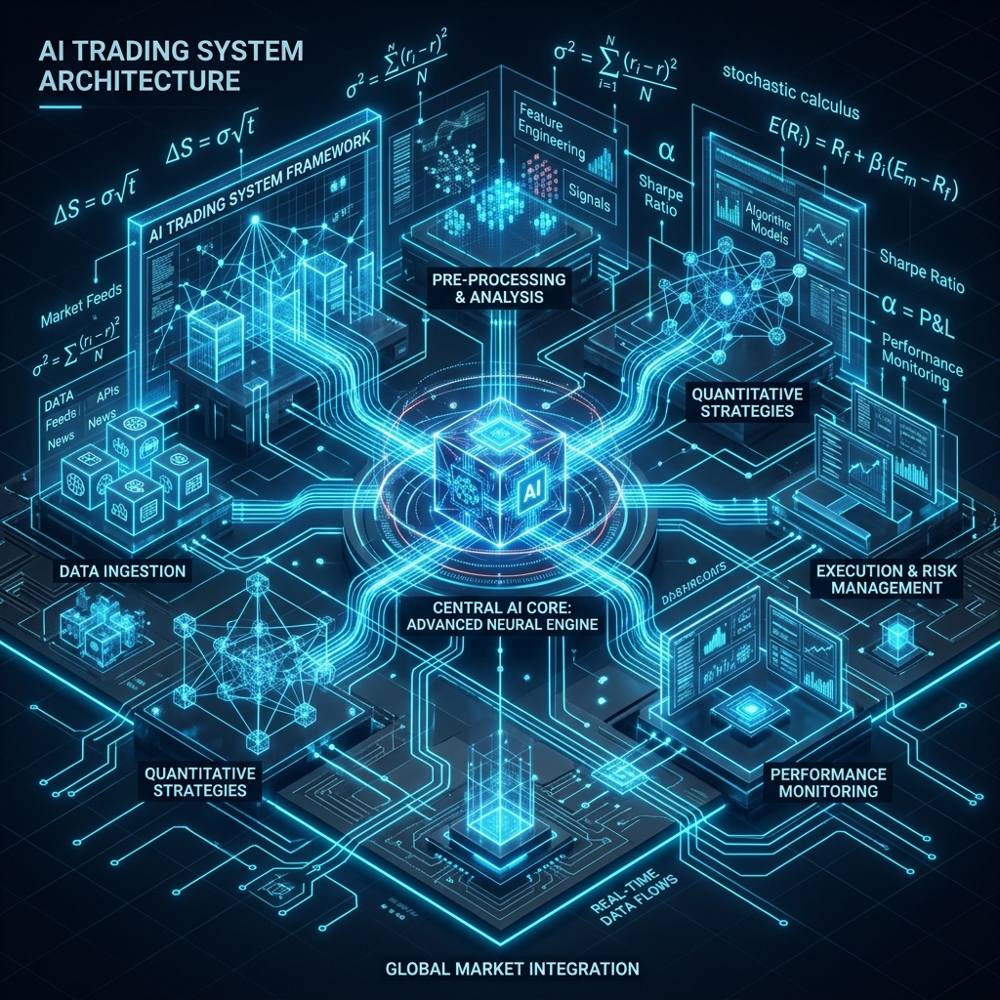
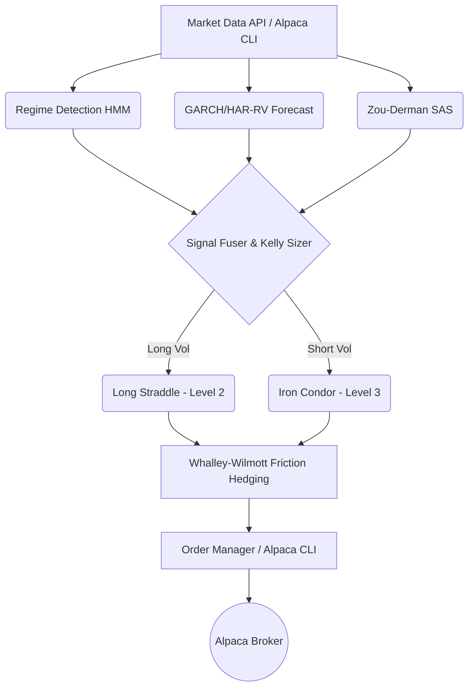

<div align="center">
  

  # Alpaca Volatility Agent 🦙📉
  
  **An autonomous options volatility-trading & hedging agent for Alpaca's paper trading environment.**
  
  *Built for the [Alpaca AI Trading Agents Hackathon](https://lablab.ai/ai-hackathons/alpaca-ai-trading-agents-hackathon)*

  [](https://opensource.org/licenses/MIT)
  [](https://www.python.org/downloads/)
  [](https://alpaca.markets/docs/)
  [](https://alpha-trading-deployment-lastcommit-dun.vercel.app/dashboard)

  ### 🌐 **Live Web Application & Research Terminal**
  **[https://alpha-trading-deployment-lastcommit-dun.vercel.app/dashboard](https://alpha-trading-deployment-lastcommit-dun.vercel.app/dashboard)**
</div>

---

> ## 🔔 v3 update
> This project went through a major rewrite pass: real historical
> IV/event data replacing several approximations, a walk-forward
> backtest that trades the actual live strategy, CVaR-aware position
> construction, order reconciliation, a faster/pooled Alpaca client,
> and the rebuilt dashboard below — plus a handful of real bugs found
> and fixed along the way (a vega-sizing units bug that was silently
> blocking most long-vol trades, per-leg exit logic that would have
> stopped out a winning iron condor's own protective wings, a syntax
> error that made `market_auto_loop.py` unusable, and others).
> **Read [CHANGES_V3.md](CHANGES_V3.md) for the complete, itemized
> list**, and **[SECURITY.md](SECURITY.md) before doing anything else**
> if you're reusing credentials from an earlier copy of this project.

---

## ⚡ The Elevator Pitch

**Alpaca Vol Agent** is an autonomous, quantitative options trading system that harvests volatility risk premium (VRP). It fuses a regime-conditional HMM, GARCH/HAR-RV volatility forecasting, and Kelly sizing with transaction-cost-aware hedging—all executing seamlessly through Alpaca's official CLI.

This isn't just an LLM making random guesses. It's a mathematically grounded **Volatility-Harvesting Agent** combined with a **Portfolio Hedge Overlay**, representing the pinnacle of "Options Alpha" for this hackathon.

---

## 📸 Trading Dashboard (v3)

> **v3 rebuilt `dashboard.html` from scratch** with a real candlestick
> chart (TradingView's `lightweight-charts`), a live-polling order
> blotter, a positions/Greeks table, a composite-signal panel, a risk
> panel with Greek-headroom bars and loss-breaker banners, an upcoming
> FOMC/CPI/NFP events calendar, an equity curve, and a "Run Cycle"
> control. Run `uvicorn api.server:app --reload` and open
> `http://localhost:8000/dashboard` to see it live — see
> **[CHANGES_V3.md](CHANGES_V3.md)** for the full list of what changed
> and why, including the fix for orders and the decision log drifting
> out of sync with each other.
>
> *(The screenshot gallery this section used to show referenced seven
> image files — `assets/screenshots/01_terminal_overview.png` through
> `07_decision_audit_log.png` — that aren't actually present in this
> repository, so they rendered as broken links; removed rather than
> left broken. If you have those images from an earlier version of this
> project, dropping them back into `assets/screenshots/` and restoring
> this section is straightforward.)*

---

## 🌪️ The Problem & The Solution

**The Problem:** Most AI trading agents are either "black boxes" blindly firing API requests or lack a true mathematical edge, ignoring critical constraints like transaction costs, portfolio greeks, and broker-specific options levels.

**The Solution:**
Our agent reads real implied volatility directly off Alpaca's live chain, cross-validates it using an independent, purely historical signal (Zou-Derman Strike-Adjusted Spread), and executes fractional-Kelly sized Iron Condors or Straddles. Every trade is delta-hedged using a min-variance ratio with Whalley-Wilmott no-trade bands to prevent bleeding out to spread and slippage.

---

## 🧠 Core Alpha Architecture

<div align="center">
  
</div>

Our architecture represents a sophisticated pipeline, not a simple heuristic:



### 1. Regime-Conditional HMM
4-state Hidden Markov Model regime detection (Range, Trend, Vol_Expansion, Crash).

### 2. Live VRP & Volatility Forecasting
GARCH(1,1) + HAR-RV blended forecast checked against live implied volatility read straight from Alpaca's option chain.

### 3. Rigorous Hedging & Sizing
Fractional-Kelly risk budget with gamma/vega capped limits. Re-sizes dynamically based on the current book's actual risk.

---

## 🛡️ Tooling Compliance (READ THIS)

**The playbook requires using Alpaca's MCP server or CLI.** 
This project strictly routes **every** Alpaca call through `subprocess.run(["alpaca", "api", METHOD, path, ...])`. 

We use the official CLI's raw escape hatch (`alpaca api METHOD <path>`). Nothing here calls `requests` or `alpaca-py` directly for trading. This ensures robust tooling compliance while maintaining the lightning-fast execution required for options delta hedging.

*(See the `OLD_README.md` for our extended writeup on Alpaca Trading Level Constraints).*

---

## 🚀 Quickstart Guide

### 1. Setup your Environment
Create a **NEW** paper account at [Alpaca](https://app.alpaca.markets).
Install the Alpaca CLI (Required for Tooling Compliance):
```bash
go install github.com/alpacahq/cli/cmd/alpaca@latest
alpaca version
```

### 2. Configure Credentials
```bash
export ALPACA_API_KEY=PK...
export ALPACA_SECRET_KEY=...
alpaca account get --quiet
```

### 3. Install Python Dependencies
```bash
git clone https://github.com/WoLfy15/ALPACA-VOL-AGENT.git "Alpaca Trading"
cd "Alpaca Trading"
pip install -r requirements.txt
cp .env.example .env
```

### 4. Run the Agent (Dry-Run Mode)
Computes everything (regime, forecast vol, SAS, sizing) without submitting real orders.
```bash
python cli.py run --once
```

### 5. Go Live (Paper Trading)
Ready to dominate? Start the live loop:
```bash
python cli.py run --loop --interval 900 --live
```

### 6. Launch the Dashboard Backend
```bash
python cli.py serve --port 8000
```

---

## 🔮 Roadmap

- **RL execution extension — partially landed in v3.** Real TWAP/VWAP
  child-order slicing is live (`execution/execution_optimizer.py`),
  validated against a "dump it all at once" baseline. The trained PPO
  agent itself is **not** wired in: it was trained on
  `execution_env.py`'s synthetic Hawkes limit-order-book observation
  space, and there's no validated mapping from that into "how many SPY
  option contracts are left to fill." `RLExecutionAdapter` is a real,
  documented interface that raises rather than guesses — see
  [CHANGES_V3.md](CHANGES_V3.md) item 17. Making this real is genuine
  future work: either retrain against an options-specific execution
  environment, or hand-build and backtest a feature mapping first.
- **Rough volatility surface calibrator — not yet wired in.** The
  `rough_vol_kaggle` project's neural rough-Bergomi calibrator has no
  shipped trained checkpoint and depends on `torch` plus specific
  surface/path-signature features this project doesn't compute.
  `research/vol_forecast.forecast_horizon`'s GARCH-simulation-based
  probabilistic forecast is what's real and active today (item 6); a
  richer rough-vol layer is a real upgrade path once a checkpoint and a
  validated feature pipeline exist for THIS project's own chain data,
  not just the calibrator's own training set.
- **A real historical options IV surface.** `data/historical_iv.py`
  ships real CBOE VIX as the historical proxy (a genuine improvement
  over a multiple of realized vol) but has no per-strike skew or
  multi-tenor term structure. `IVSurfaceProvider` is the seam a paid
  vendor feed (OptionMetrics, ORATS, CBOE DataShop) plugs into without
  any caller changing.

---

*For deep, extensive technical details on the underlying math, please reference `OLD_README.md`. For the full v3 rewrite (what changed, what was found and fixed, what's honestly still outstanding), see `CHANGES_V3.md`.*

<div align="center">
  <sub>Built with ❤️ and Math for the Alpaca AI Hackathon. Let's win this.</sub>
</div>
